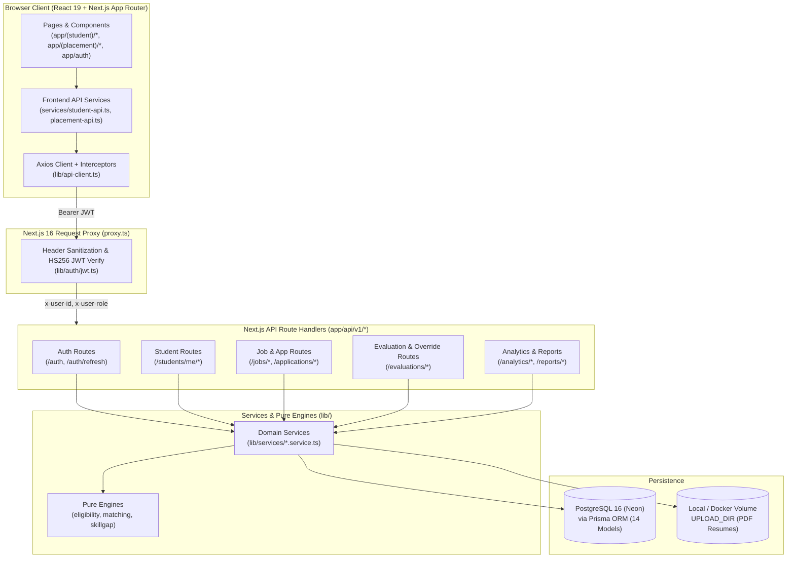
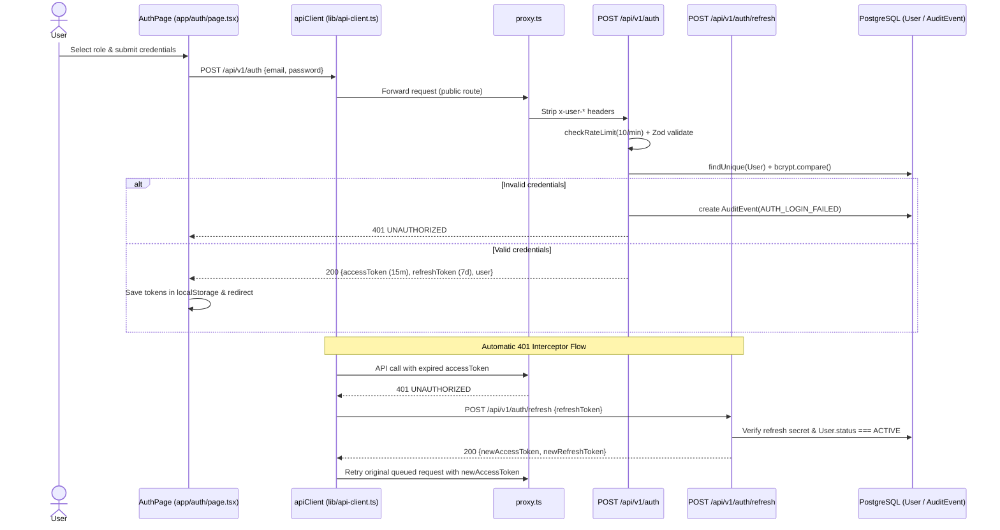
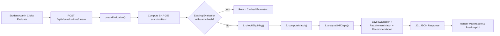
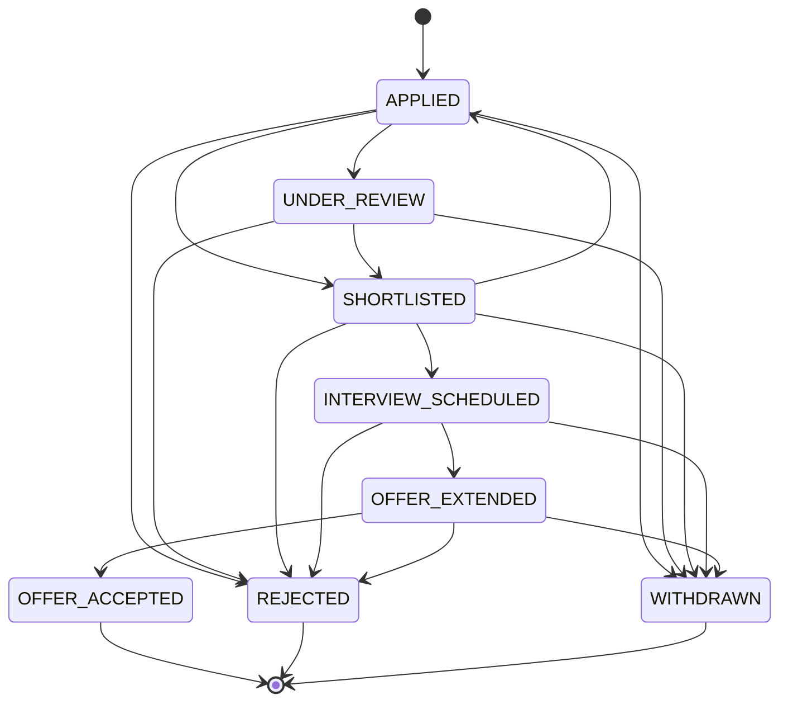

# PeerSphere — Complete End-to-End Application Workflow

This document traces every major workflow in **PeerSphere** from user interaction through the frontend, API layer, business logic, database, and final UI output, referencing exact files, functions, API routes, and Prisma models.

---

## 1. High-Level System Architecture

---

## 2. New User Onboarding & Authentication Flow

1. **Landing Page (`app/page.tsx`):** A new user visits `/`, views the explainability showcase, and clicks **Enter as student** or **Enter as placement officer** (`/auth`).
2. **Role Selection (`app/auth/page.tsx`):** User selects **Student** or **Placement Officer**. Demo credentials from `prisma/seed.ts` (`arjun.sharma@college.edu` / `student123` or `placement@college.edu` / `admin123`) are pre-filled for convenience.
3. **Login Request:**
   - **Frontend:** `useAuth().login()` → `lib/auth.ts:login()` sends `POST /api/v1/auth` with `{ email, password }`.
   - **Proxy (`proxy.ts`):** Matches `/api/v1/auth` (`POST`) as a `PUBLIC_ROUTE`, strips any spoofed `x-user-*` headers, and forwards the request.
   - **Backend (`app/api/v1/auth/route.ts`):**
     - Checks sliding-window rate limit (`checkRateLimit('login:<ip>', 10, 60_000)`).
     - Validates body with Zod (`loginSchema`).
     - Queries `prisma.user.findUnique({ where: { email } })`, checks `user.status === 'ACTIVE'`, and verifies password via `bcrypt.compare(password, user.passwordHash)`.
     - On failure, logs `AUTH_LOGIN_FAILED` to `AuditEvent` and returns `401`.
     - On success, signs HS256 `accessToken` (`15m` TTL) and `refreshToken` (`7d` TTL) via Web Crypto (`lib/auth/jwt.ts:signToken`).
   - **Frontend Storage:** Stores `peersphere_access_token`, `peersphere_refresh_token`, and `peersphere_user` in `localStorage`, then redirects to `/student` or `/placement`.

### Authentication & Token Refresh Sequence

---

## 3. Protected Navigation & Session Management

- **Route Guards:** `app/(student)/layout.tsx` and `app/(placement)/layout.tsx` wrap pages in `ProtectedRouteWithRole` (`components/auth/ProtectedRoute.tsx`), verifying `user.role` (`STUDENT` vs `PLACEMENT_ADMIN`).
- **API Authorization:** Every non-public `/api/v1/*` request passes through `proxy.ts`, which verifies the `Authorization: Bearer <token>` header and injects trusted `x-user-id` and `x-user-role` headers read by `getAuthUser(request)` (`lib/auth/request.ts`).
- **Logout:** Calling `logout()` (`lib/auth.ts`) invokes `clearAuth()`, removing `peersphere_access_token`, `peersphere_refresh_token`, and `peersphere_user` from `localStorage` and redirecting to `/auth`.

---

## 4. Major Feature Workflows

### Feature A: AI Match Evaluation & Skill-Gap Roadmap Generation

**Flow:** **User Action → Frontend → API/Backend → Business Logic → Database → Response → UI Output**

1. **User Action:** Student clicks **"Run Match Analysis"** on a job (`/student/jobs/[id]` or `/student/match`), or Placement Admin queues an evaluation.
2. **Frontend (`services/student-api.ts`):** Calls `queueEvaluation(studentId, jobId)` → `POST /api/v1/evaluations/queue`.
3. **Proxy & Route Handler (`app/api/v1/evaluations/queue/route.ts`):**
   - `proxy.ts` verifies JWT and sets `x-user-id` / `x-user-role`.
   - Handler validates `{ studentId?, jobId }` via Zod (`queueEvaluationSchema`). If `user.role === 'STUDENT'`, it resolves `studentId` from `user.userId` (preventing IDOR).
4. **Business Logic (`lib/services/evaluations.service.ts:queueEvaluation`):**
   - Fetches latest published `JobVersion` with `requirements` and `Student` with `skillEvidence`.
   - Constructs `inputSnapshot` and computes SHA-256 `snapshotHash` (excluding timestamp).
   - **Idempotency Check:** Queries `prisma.evaluation.findFirst({ where: { snapshotHash } })`. If found, returns cached evaluation immediately.
   - Otherwise creates `Evaluation` (`status: 'QUEUED'`) and runs 3 pure engines:
     1. `checkEligibility()` (`lib/engines/eligibility.engine.ts`) → `ELIGIBLE` | `INELIGIBLE` | `CONDITIONAL` | `PENDING`.
     2. `computeMatch()` (`lib/engines/matching.engine.ts`) → `overallScore`, `confidenceScore`, `coveragePercent`, `requiresReview`, `details[]`.
     3. `analyzeSkillGaps()` (`lib/engines/skillgap.engine.ts`) → prioritized `SkillGapResult[]` with `steps`, `potentialLift`, `estimatedWeeks`.
5. **Database Writes:** Updates `Evaluation` (`COMPLETED` or `REVIEW_REQUIRED`), bulk-inserts `RequirementMatch` rows and `Recommendation` rows.
6. **Response & UI Output:** Returns `201` with full evaluation payload. Frontend renders `MatchScore`, `EligibilityBadge`, `SkillChip` breakdown, and `SkillGapCard` / `RecommendationCard` (`/student/skill-gaps`, `/student/recommendations`).

---

### Feature B: Student Job Application & Admin Status Pipeline

1. **User Action:** Student clicks **Apply** on a published job (`/student/jobs/[id]`).
2. **Frontend:** `applyToJob(jobId)` → `POST /api/v1/jobs/[jobId]/apply`.
3. **Backend (`app/api/v1/jobs/[jobId]/apply/route.ts` → `lib/services/applications.service.ts:applyToJob`):**
   - Verifies job exists and `status === 'PUBLISHED'`.
   - Fetches latest `JobVersion` and rejects if `deadline < new Date()` (`422 UNPROCESSABLE`).
   - Runs eligibility check (`CGPA`, `activeBacklogs`, `allowedDepartments`, `allowedPrograms`). If `INELIGIBLE`, returns `422` with reasons.
   - Checks `studentId_jobId` unique constraint; if not already applied, executes `prisma.$transaction` to create `Application` (`APPLIED`) and increment `JobVersion.applicationCount`.
4. **Admin Pipeline Update:** Placement officer updates status via `PATCH /api/v1/applications/[id]` → `updateApplicationStatus()`. Enforces `VALID_TRANSITIONS` state machine (`409 CONFLICT` on invalid transitions) and writes an `AuditEvent` (`APPLICATION_STATUS_CHANGED`).

---

### Feature C: PDF Resume Upload, Verification & Download

1. **User Action:** Student uploads a PDF resume on `/student/profile`.
2. **Frontend (`services/student-api.ts:uploadResume`):** Sends `multipart/form-data` with field `resume` to `POST /api/v1/students/me/resumes`.
3. **Backend (`app/api/v1/students/me/resumes/route.ts` → `lib/services/resumes.service.ts:uploadResume`):**
   - Validates `file.type === 'application/pdf'` and `size <= 5MB`.
   - **Magic-Byte Check:** Verifies the first 5 bytes of the buffer equal `%PDF-` (`isPdfContent()`), preventing spoofed MIME types.
   - Generates a random 16-byte hex `storageKey`, writes file to `UPLOAD_DIR`, computes SHA-256 `checksum`, creates `ResumeVersion` (`state: 'UPLOADED'`), and recalculates `Student.profileCompleteness`.
4. **Download (`GET /api/v1/students/me/resumes/[id]/download`):** Frontend fetches blob via `apiClient` (so `Authorization: Bearer` header is attached) and triggers browser download via `URL.createObjectURL`.

---

### Feature D: Placement Officer Job Lifecycle & Audited Review Overrides

1. **Job Creation & Publishing:**
   - Admin submits job form (`/placement/jobs`) → `POST /api/v1/jobs` (`createJob()` creates `Job` in `DRAFT` + `JobVersion` v1 + `JobRequirement` rows via `findOrCreateSkill` upsert).
   - Editing a `DRAFT` job (`PATCH /api/v1/jobs/[jobId]`) creates a new `JobVersion` (`version + 1`).
   - Publishing (`POST /api/v1/jobs/[jobId]/publish`) runs a `prisma.$transaction` setting `Job.status = 'PUBLISHED'`, `JobVersion.publishedAt = now()`, and creating an `AuditEvent` (`JOB_PUBLISHED`).
2. **Audited Review Override (`/placement/candidates/[id]`):**
   - Admin selects decision (`shortlist | reject | review | promote`) and enters a mandatory `reason`.
   - `POST /api/v1/evaluations/[evaluationId]/override` → `overridesService.createOverride()` runs a transaction creating an append-only `ReviewOverride` and an `AuditEvent` (`EVALUATION_OVERRIDE`) without mutating the original `Evaluation`.

---

### Feature E: Cohort Analytics & Live Reports

1. **Dashboard Analytics:**
   - `GET /api/v1/analytics/placement-stats` → `getPlacementStats()` aggregates student count, active jobs, applications, shortlists, offers, average match/confidence scores, and placement rate.
   - `GET /api/v1/analytics/skill-gaps` → `getSkillGaps()` groups `RequirementMatch` (`matchState: 'MISSING'`) by distinct student and assigns cohort-relative priority (`>= 50%` high, `>= 25%` medium, `< 25%` low).
2. **Live Reports & CSV Export (`/placement/reports`):**
   - `GET /api/v1/reports/[id]` → `generateReport()` computes live sections from PostgreSQL for 6 report types (`placement-summary`, `skill-gap-analysis`, `department-wise-placement`, `company-recruitment`, `student-readiness`, `evaluation-audit`).
   - Frontend renders the report in a modal and offers client-side UTF-8 BOM CSV download via `downloadReportCsv()`.
