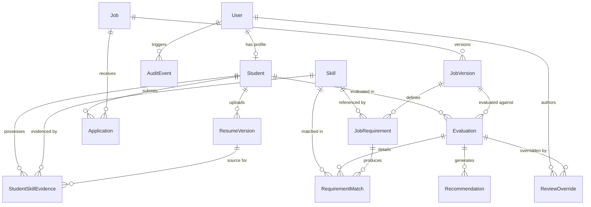

# PeerSphere — Technical Reference

A verified reference of the repository's directory structure, database schema, core engines, API endpoints, dependencies, and key code patterns.

---

## 1. Repository Structure

| Path | Purpose |
|---|---|
| `app/` | Next.js 16 App Router pages, layouts, and API route handlers |
| `app/page.tsx` | Public landing page with interactive explainability showcase |
| `app/auth/page.tsx` | Role selection & credential sign-in page |
| `app/(student)/student/*` | Student portal pages (dashboard, jobs, match, skill-gaps, recommendations, applications, profile) |
| `app/(placement)/placement/*` | Placement Admin portal pages (dashboard, jobs, candidates, compare, applications, students, analytics, reports) |
| `app/api/v1/*` | RESTful JSON API route handlers |
| `proxy.ts` | Next.js 16 request proxy for `/api/v1/*` JWT verification & header sanitization |
| `lib/engines/` | Pure-function deterministic engines (`eligibility`, `matching`, `skillgap`) |
| `lib/services/` | Backend business logic & Prisma database operations |
| `lib/auth/` | Web Crypto HS256 JWT (`jwt.ts`), rate limiter (`rate-limit.ts`), env (`env.ts`), request helper (`request.ts`) |
| `lib/api/response.ts` | Standardized `ApiResponse` / `ApiError` JSON response builders |
| `lib/errors/api-error.ts` | `ApiError` class and `isApiError()` type guard |
| `lib/api-client.ts` | Axios client with 401 refresh-token queue & auto-retry |
| `prisma/schema.prisma` | PostgreSQL schema (14 models, 11 enums) |
| `prisma/seed.ts` | Idempotent seed script (20 skills, 6 users, 5 students, 5 jobs, 7 applications, 7 evaluations) |
| `services/` | Typed frontend API wrappers (`student-api.ts`, `placement-api.ts`) |
| `components/` | Reusable UI (`ui/`), domain (`product/`), layout (`layout/`), auth (`auth/`), PWA (`pwa/`) |
| `styles/` | Design tokens (`tokens.css`), glassmorphism (`glass.css`), clay (`clay.css`), `premium.css` |
| `__tests__/` | Jest unit, engine, API integration, and security tests |
| `e2e/` | Playwright end-to-end and `@axe-core/playwright` accessibility tests |

---

## 2. Database Schema (Prisma ORM — PostgreSQL 16)

### Models Summary (`prisma/schema.prisma`)
1. **`User`** (`users`): `id`, `email` (unique), `passwordHash`, `role` (`STUDENT | PLACEMENT_ADMIN`), `status` (`ACTIVE | SUSPENDED | DELETED`).
2. **`Student`** (`students`): `id`, `userId` (unique), `name`, `rollNumber` (unique), `department`, `program`, `year`, `cgpa` (`Decimal(4,2)`), `activeBacklogs`, `totalBacklogs`, `profileCompleteness`, `placementReadiness`.
3. **`Skill`** (`skills`): `id`, `canonicalName` (unique), `category`, `taxonomyVersion`, `aliases` (`String[]`), `deprecatedAt`.
4. **`StudentSkillEvidence`** (`student_skill_evidence`): `@@unique([studentId, skillId])`, `source` (`RESUME | MANUAL | VERIFIED`), `evidenceText`, `proficiency`, `confidence` (0–100).
5. **`ResumeVersion`** (`resume_versions`): `storageKey` (unique), `originalName`, `checksum` (SHA-256), `mimeType`, `sizeBytes`, `state` (`ResumeState`), `deletedAt`.
6. **`Job`** (`jobs`): `id`, `createdById`, `status` (`DRAFT | PUBLISHED | CLOSED | ARCHIVED`).
7. **`JobVersion`** (`job_versions`): `@@unique([jobId, version])`, `title`, `company`, `location`, `workMode`, `jobType`, `salary`, `description`, `deadline`, `minCgpa`, `maxBacklogs`, `allowedDepartments[]`, `allowedPrograms[]`, `applicationCount`, `shortlistedCount`.
8. **`JobRequirement`** (`job_requirements`): `type` (`HARD | SOFT`), `skillId`, `weight`, `required`, `label`.
9. **`Evaluation`** (`evaluations`): `inputSnapshot` (`Json`), `snapshotHash`, `eligibility` (`EligibilityStatus`), `status` (`EvaluationStatus`), `overallScore`, `confidenceScore`, `coveragePercent`, `matchSummary`, `algorithmVersion` (`"2.1.0"`), `requiresReview`, `reviewNote`. Indexes: `[studentId, createdAt]`, `[jobVersionId, overallScore]`, `[snapshotHash]`.
10. **`RequirementMatch`** (`requirement_matches`): `matchState` (`STRONG | PARTIAL | MISSING`), `contribution` (`0 | 0.5 | 1.0`), `explanation`. Index: `[matchState]`.
11. **`Recommendation`** (`recommendations`): `skillName`, `priority`, `reason`, `steps[]`, `potentialLift`, `estimatedWeeks`.
12. **`Application`** (`applications`): `@@unique([studentId, jobId])`, `status` (`ApplicationStatus`), `notes`. Indexes: `[jobId, status]`, `[status, appliedAt]`.
13. **`ReviewOverride`** (`review_overrides`): Append-only `decision` (`shortlist | reject | review | promote`), `reason`, `actorId`.
14. **`AuditEvent`** (`audit_events`): Append-only `actorId`, `action`, `resourceType`, `resourceId`, `requestId`, `metadata` (`Json`). Indexes: `[resourceType, resourceId, createdAt]`, `[createdAt]`.

---

## 3. Core Algorithms & Pure Engines (`lib/engines/`)

### 3.1 Eligibility Engine (`lib/engines/eligibility.engine.ts`)
Function: `checkEligibility(input: EligibilityInput): EligibilityResult`
- Evaluates 4 rules:
  1. **CGPA:** `studentCgpa < minCgpa` → fail; `studentCgpa === null` → conditional (`CGPA not yet verified`).
  2. **Active Backlogs:** `studentActiveBacklogs > maxBacklogs` → fail.
  3. **Department:** Case-insensitive membership in `allowedDepartments` (skipped if empty).
  4. **Program:** Case-insensitive membership in `allowedPrograms` (skipped if empty).
- **Status Precedence:** `INELIGIBLE` (any hard failure) → `PENDING` (`studentCgpa === null` and no failures) → `CONDITIONAL` (soft reasons) → `ELIGIBLE`.

### 3.2 Matching Engine (`lib/engines/matching.engine.ts`)
Function: `computeMatch(studentSkills, jobRequirements): MatchingResult`
- **Match Resolution (`findBestMatch`):**
  1. Exact match (case-insensitive)
  2. Alias match against `Skill.aliases[]`
  3. Substring overlap fallback
- **Scoring Rules:**
  - `STRONG` (`contribution = 1.0`): `(exact || alias)` and `confidence >= 75`.
  - `PARTIAL` (`contribution = 0.5`): `(exact || alias)` with `confidence >= 40` OR `substring`.
  - `MISSING` (`contribution = 0.0`): No match or `confidence < 40`.
- **Formulas:**
  - $\text{overallScore} = \text{round}\left(\frac{\sum_{r \in \text{required}} \text{contribution}_r \cdot \text{weight}_r}{\sum_{r \in \text{required}} \text{weight}_r} \times 100\right)$
  - $\text{coveragePercent} = \text{round}\left(\frac{\text{requiredMatched}}{\text{requiredTotal}} \times 100\right)$
  - $\text{confidenceScore} = \text{clamp}_{0..100}\left(\text{round}\left(\frac{\sum \text{confidence}_r \cdot \text{weight}_r}{\sum \text{weight}_r}\right)\right)$
- **Human Review Trigger:** `requiresReview = (confidenceScore < 60) || hasConflictingAliases`.

### 3.3 Skill-Gap Engine (`lib/engines/skillgap.engine.ts`)
Function: `analyzeSkillGaps(input: GapInput): SkillGapResult[]`
- Processes `MISSING` and `PARTIAL` requirement matches.
- **Priority & Lift:**
  - `MISSING` + `required` + `weight >= 1.5` → `high` priority, `5` weeks, $\text{potentialLift} = \lceil (\text{weight} / \text{totalWeight}) \times 30 \rceil$.
  - `MISSING` + `required` + `weight < 1.5` → `medium` priority, `3` weeks, $\text{potentialLift} = \lceil (\text{weight} / \text{totalWeight}) \times 30 \rceil$.
  - `MISSING` + optional → `low` priority, `2` weeks, $\text{potentialLift} = \lceil (\text{weight} / \text{totalWeight}) \times 15 \rceil$.
  - `PARTIAL` → `medium` priority, `3` weeks, $\text{potentialLift} = \lceil (\text{weight} / \text{totalWeight}) \times 15 \rceil$.
- **Category Roadmaps:** `detectCategory()` maps skill names across 13 categories (`programming`, `database`, `cloud`, `devops`, `ml`, `webfrontend`, `webbackend`, `mobile`, `softskills`, `testing`, `security`, `data`, `general`) to generate 5 ordered improvement steps.

---

## 4. Complete API Endpoint Inventory (`/api/v1/*`)

| Endpoint | Methods | Auth / Role | Purpose |
|---|---|---|---|
| `/api/v1/auth` | `GET`, `POST` | Public | API info; email/password login (rate-limited 10/min) |
| `/api/v1/auth/refresh` | `POST` | Public | Rotate access & refresh tokens (rate-limited 30/min) |
| `/api/v1/students/me` | `GET`, `PATCH` | `STUDENT` | Get/update own profile & completeness |
| `/api/v1/students/me/skills` | `GET`, `POST` | `STUDENT` | List or add manual skill evidence |
| `/api/v1/students/me/skills/[skillId]` | `DELETE` | `STUDENT` | Remove skill evidence |
| `/api/v1/students/me/resumes` | `GET`, `POST` | `STUDENT` | List or upload PDF resume (`%PDF-` + 5MB limit) |
| `/api/v1/students/me/resumes/[id]` | `DELETE` | `STUDENT` | Soft-delete resume version |
| `/api/v1/students/me/resumes/[id]/download` | `GET` | `STUDENT` | Stream PDF resume file |
| `/api/v1/students/me/applications` | `GET` | `STUDENT` | List student's applications + latest evaluation |
| `/api/v1/students/me/evaluations` | `GET` | `STUDENT` | List student's evaluations |
| `/api/v1/students` | `GET` | `PLACEMENT_ADMIN` | Paginated, searchable student directory |
| `/api/v1/students/[id]` | `GET` | `PLACEMENT_ADMIN` | Student detail view |
| `/api/v1/jobs` | `GET`, `POST` | Public (`GET`), `PLACEMENT_ADMIN` (`POST`) | List jobs (public sees `PUBLISHED` only); create `DRAFT` job |
| `/api/v1/jobs/[jobId]` | `GET`, `PATCH` | Authenticated / `PLACEMENT_ADMIN` | Job details; update `DRAFT` job (creates new `JobVersion`) |
| `/api/v1/jobs/[jobId]/publish` | `POST` | `PLACEMENT_ADMIN` | Publish job + log `JOB_PUBLISHED` |
| `/api/v1/jobs/[jobId]/close` | `POST` | `PLACEMENT_ADMIN` | Close job |
| `/api/v1/jobs/[jobId]/apply` | `POST` | `STUDENT` | Apply to published job (checks deadline & eligibility) |
| `/api/v1/jobs/[jobId]/applications` | `GET` | `PLACEMENT_ADMIN` | List applications for a job with match scores |
| `/api/v1/jobs/[jobId]/evaluations` | `GET` | `PLACEMENT_ADMIN` | Ranked evaluations for latest published `JobVersion` |
| `/api/v1/applications` | `GET` | `PLACEMENT_ADMIN` | Paginated all-applications list |
| `/api/v1/applications/[id]` | `GET`, `PATCH`, `DELETE` | Authenticated / `PLACEMENT_ADMIN` | Update application status (enforces state machine) |
| `/api/v1/evaluations` | `GET` | `PLACEMENT_ADMIN` | List all evaluations |
| `/api/v1/evaluations/queue` | `POST` | `STUDENT`, `PLACEMENT_ADMIN` | Run/retrieve idempotent evaluation |
| `/api/v1/evaluations/[evaluationId]` | `GET`, `PATCH` | Owner / `PLACEMENT_ADMIN` | View or update evaluation |
| `/api/v1/evaluations/[evaluationId]/override` | `POST` | `PLACEMENT_ADMIN` | Append-only review override + `AuditEvent` |
| `/api/v1/evaluations/[evaluationId]/overrides` | `GET` | `PLACEMENT_ADMIN` | Override history for an evaluation |
| `/api/v1/overrides` | `GET` | `PLACEMENT_ADMIN` | List overrides |
| `/api/v1/analytics/placement-stats` | `GET` | `PLACEMENT_ADMIN` | Batch placement KPIs |
| `/api/v1/analytics/skill-gaps` | `GET` | `PLACEMENT_ADMIN` | Top 10 missing skills across cohort |
| `/api/v1/reports` | `GET` | `PLACEMENT_ADMIN` | Catalog of 6 available reports |
| `/api/v1/reports/[id]` | `GET` | `PLACEMENT_ADMIN` | Generate live report JSON |
| `/api/v1/audit-log` | `GET` | `PLACEMENT_ADMIN` | Paginated audit trail |

---

## 5. Dependencies & Environment Variables

### Production Dependencies (`package.json`)
- `next` (`16.3.1`), `react` (`19.2.8`), `react-dom` (`19.2.8`)
- `@prisma/client` (`5.22.0`), `zod` (`3.23.8`), `bcryptjs` (`2.4.3`), `axios` (`^1.7.7`)
- `framer-motion` (`^13.1.0`), `lucide-react` (`^1.31.0`), `recharts` (`^3.10.1`), `clsx` (`^2.1.1`)

### Environment Variables (`.env.example`)
- `DATABASE_URL` — PostgreSQL 16 connection string (Neon pooled URL with `?sslmode=require`)
- `JWT_SECRET` — Min 32 chars (required at boot)
- `JWT_REFRESH_SECRET` — Min 32 chars (required at boot)
- `JWT_EXPIRES_IN` — Default `"15m"`
- `JWT_REFRESH_EXPIRES_IN` — Default `"7d"`
- `UPLOAD_DIR` — Default `"./uploads"` (or `"/data/uploads"` in `Dockerfile`)
- `MAX_FILE_SIZE_MB` — Default `5`
